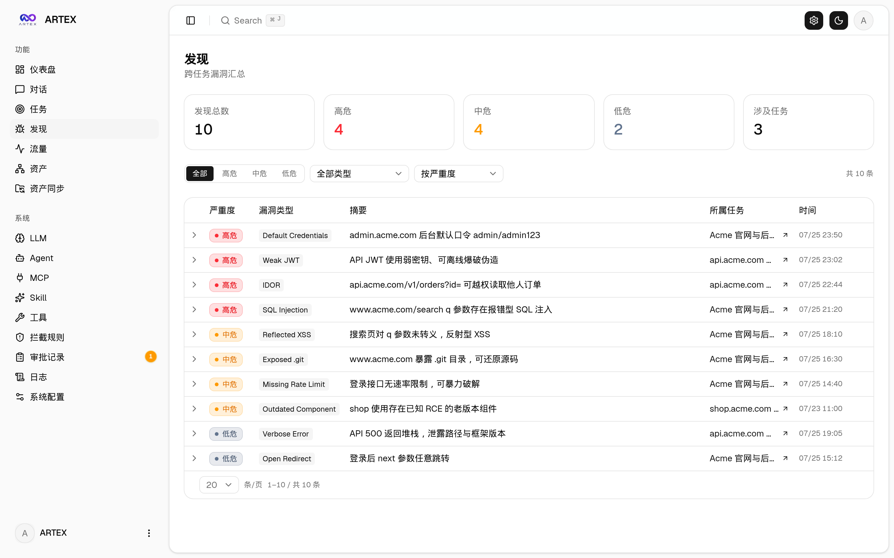
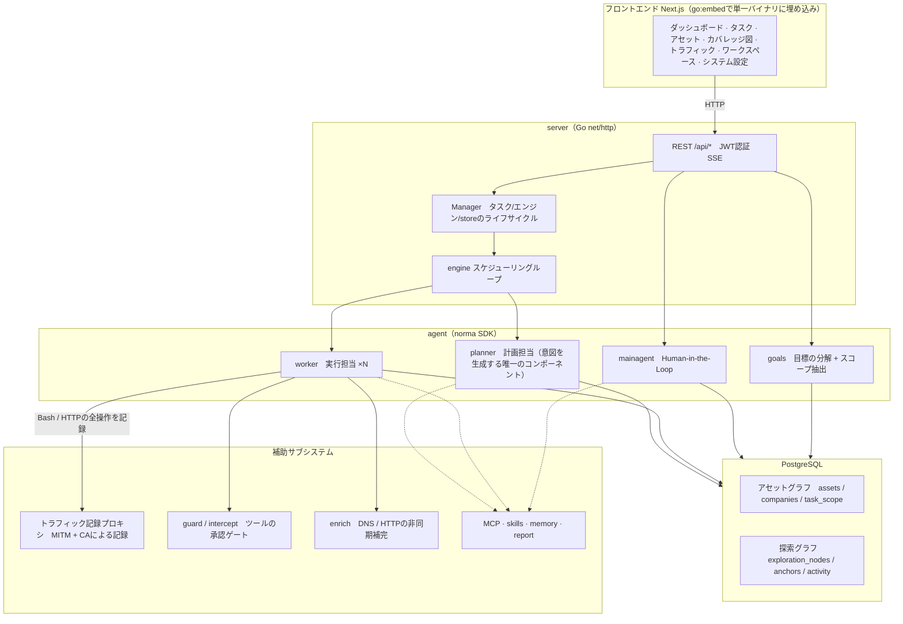
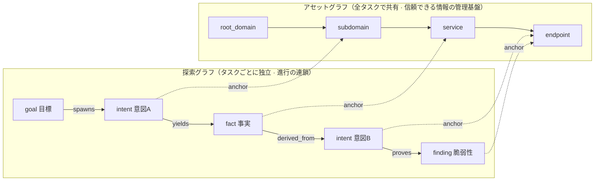
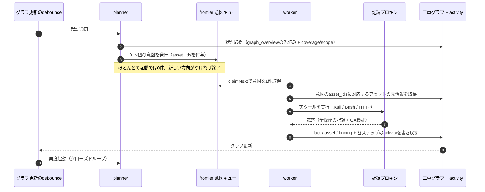
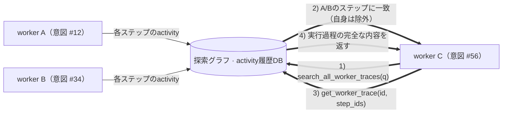
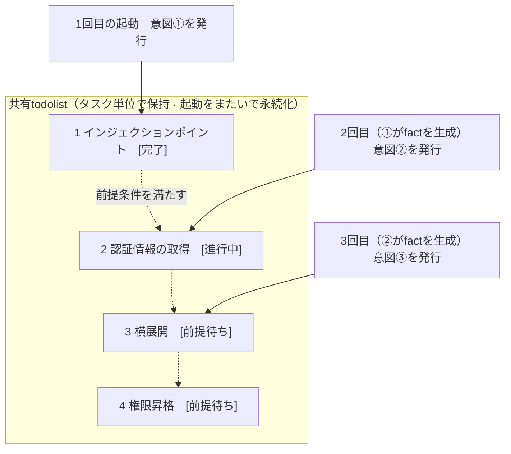

<div align="center">

# ARTEX

AIによる自律型ペネトレーションテストシステム（Goバックエンド + Next.jsフロントエンド）


🌐 **オンラインデモ**： [https://artex-demo.vercel.app/](https://artex-demo.vercel.app/)

</div>

---

## スクリーンショット

> 実際の操作については[オンラインデモ](https://artex-demo.vercel.app/)を参照。

| ダッシュボード（概要 / Token消費量 / アクティビティフィード） | タスク一覧 |
| :---: | :---: |
|  |  |

| タスク・実行履歴（セッション / ツール呼び出し） | 探索経路 |
| :---: | :---: |
|  |  |

| 検出結果 | アセット |
| :---: | :---: |
|  |  |

| アセットのテストカバレッジ図（力指向レイアウト・テスト済みの強調表示・ノードの折りたたみと展開） |
| :---: |
|  |

| トラフィック記録 | Human-in-the-Loop対話 |
| :---: | :---: |
|  |  |

| Agent管理 | LLM設定 |
| :---: | :---: |
|  |  |

| インターセプト承認 | バックエンドログ |
| :---: | :---: |
|  |  |


---

## 承認履歴の詳細

グローバルの「承認履歴」、タスク内の「インターセプト承認」、対話中の承認カードは、いずれも展開して詳細を確認できる。表示構造は
[AegisHookの承認詳細コンポーネント](https://github.com/RuoJi6/AegisHook/blob/main/web/src/components/CallDetail.vue)を参考にしており、ARTEXのコンポーネントとテーマを使用している。


## アセット同期（ScopeSentry）

[ScopeSentry](https://github.com/Autumn-27/ScopeSentry)からアセット情報を直接同期でき、重複した情報収集を省略できる。

- 「**アセット同期**」画面でScopeSentryのURLとAPI Keyを入力し、データソースに接続する。
- **プロジェクト**または**タスク**単位で、同期する対象とアセット種別（ドメイン / サブドメイン / IP / ポート / サイト / エンドポイントなど）を選択する。
- ワンクリックでインポートし、企業のアセット範囲に基づいて統合する。取り込まれた情報はARTEXのアセットグラフに直接反映され、Agentによる探索に利用できる。

---

## インストール

> データベースとして**PostgreSQL**が必要。探索を行うには**LLM**の設定も必要（`ANTHROPIC_API_KEY`または`OPENAI_API_KEY`。UIからの設定も可能）。

### 方法1：一括インストールスクリプト（推奨）

```bash
git clone https://github.com/Hinln/ARTEX.git
cd ARTEX
./install.sh
```

スクリプトはDockerの検出と必要に応じた自動インストールを行い、**① すべてDockerで実行**または**② ローカルでビルドして実行**を選択できるようにする。

- **① すべてDockerで実行**：Postgresのパスワードを入力（Enterキーでランダム生成も可能）→ `.env`を自動生成 → `docker compose up -d`を実行。
- **② ローカルで実行**：データベースを選択（既存DBに接続 / Dockerで新規起動）→ `config.json`を生成 → `go`でフロントエンド埋め込みの単一バイナリをビルド → 起動。

インストール後は **http://localhost:8787** を開く（初回は`/setup`で管理者パスワードを設定）。

### 方法2：Docker Compose（手動）

```bash
git clone https://github.com/Hinln/ARTEX.git
cd ARTEX
cp .env.example .env          # POSTGRES_PASSWORDを設定。ANTHROPIC_API_KEYは任意
docker compose up -d          # autumn27/artexイメージとpostgresを取得
# → http://localhost:8787
```

イメージには一般的なツール（ripgrep/curl/vim/npm/nmapなど）が含まれている。`./skills`と`./data`はバインドマウントによって永続化される。

リモートMCPは、システム設定で`http`（Streamable HTTP）または`sse`（旧方式のSSE）を選択できる。
旧方式のSSEサーバーでは通常、`GET /sse`でイベントストリームを確立し、サーバーから返される
`/message?sessionId=...`を通じてJSON-RPCリクエストを受信する。設定時はURLを`/sse`にし、リクエストヘッダーに
`Authorization=Bearer <token>`を指定する。

### 方法3：ビルド済みバイナリをダウンロード（Releases）

[Releases](https://github.com/Hinln/ARTEX/releases)から対象プラットフォームのZIPをダウンロードする。展開すると、`artex`、`start.sh`（Windowsの場合は`start.bat`）、`skills/`、`config.example.json`が含まれている。

```bash
cp config.example.json config.json   # databaseの接続情報を設定
./start.sh                           # → http://localhost:8787
```

> `./artex`を直接実行せず、`start.sh` / `start.bat`から起動すること。この起動スクリプトは、プログラム終了時の終了コードに応じて再起動する常駐管理用スクリプトであり、**画面上の[ワンクリック更新](#方法1画面からのワンクリック更新推奨)はこれによってバイナリを入れ替える**。`./artex`を直接起動した場合、更新後に自動再起動されない。
> バックグラウンドで常駐させる場合：`nohup ./start.sh >artex.log 2>&1 &`。

### 方法4：ソースコードから単一バイナリをビルド

```bash
# 1) フロントエンドを静的エクスポート
cd web && npm ci && npm run build:static && cd ..
# 2) 埋め込み用ディレクトリへコピー
cp -r web/out server/webui/dist
# 3) ビルド（-tags embeduiを指定した場合のみフロントエンドを埋め込む）
CGO_ENABLED=0 go build -tags embedui -o artex ./cmd/artex
./start.sh
```

### 方法5：クロスプラットフォーム対応のRelease ZIPを作成

`build.sh`はフロントエンドのビルドと埋め込みを行い、Goリンカーでデバッグ情報を除去したうえで、配布ファイルをZIPにまとめる。Releaseモードでは、標準でLinux amd64/arm64、macOS amd64/arm64、Windows amd64向けのZIPを生成する。

```bash
./build.sh --release
# 生成物：dist/artex-0.3.3-*.zip
```

UPXで圧縮された自己展開形式のバイナリは、一部のLinuxカーネル、仮想化環境、セキュリティポリシーと互換性がない可能性があるため、標準では無効になっている。`ARTEX_TARGETS`でビルド対象を指定できる。実行環境での互換性を確認済みであれば、`--upx`を明示してバイナリをさらに小さくできる。

```bash
ARTEX_TARGETS=linux/amd64,windows/amd64 ./build.sh --release
./build.sh --target linux/amd64 --upx
```

---

## アップデート

> アップデートではプログラムのみを入れ替え、データには手を加えない。Postgresのデータボリューム`pgdata`、`./data`（jwt.key / SQLiteなど）、`./skills`は保持される。**データベースのマイグレーションを手動実行する必要はない**。`artex`は起動のたびに`schema.sql`（`ADD COLUMN` / `CREATE INDEX IF NOT EXISTS`を含む）を冪等に再実行するため、「再起動すればマイグレーションされる」仕組みになっている。それでも、アップデート前には`./data`とデータベースのバックアップを推奨する。

### このリポジトリのプライベートRelease更新元

画面のワンクリック更新は、常に[Hinln/ARTEX Releases](https://github.com/Hinln/ARTEX/releases)からバージョンの確認とダウンロードを行う。クローンやGitによるソースコード更新も`Hinln/ARTEX`を使用し、元プロジェクトのGo moduleパスは変更しない。

このリポジトリはプライベートリポジトリ。ARTEXのバックエンドプロセスに`ARTEX_UPDATE_GITHUB_TOKEN`を設定すること。トークンに必要な権限は、このリポジトリに対する**Contents: read**のみ。バックエンドがReleaseの確認と添付ファイルのダウンロードに使用するもので、ブラウザーには送信されない。Gitにコミットしてはいけない。

```bash
# 現在のシェルまたはサービス環境にARTEX_UPDATE_GITHUB_TOKENを安全に設定しておく
./start.sh
```

ローカルで直接起動する場合、`start.sh`は`.env`を自動読み込みしない。環境変数をプロセス環境にexportする必要がある。Docker Composeでデプロイする場合は、Gitの管理対象外にした`.env`に変数を記載し、artexコンテナを再作成できる。ただし、イメージにこのブランチの更新処理が含まれている必要があり、古いイメージのままでは更新元は切り替わらない。

画面からインストール可能な更新を表示するには、まずこのリポジトリにdraftでもprereleaseでもない正式なReleaseを公開し、`artex-<バージョン>-<os>-<arch>.zip`と`SHA256SUMS`を添付する必要がある。ソースコードしかない状態ではオンライン更新はできない。既存のReleaseワークフローは、`v*`タグのpush時に、このリポジトリ向けの添付ファイルを生成する。

### 方法1：画面からのワンクリック更新（推奨）

**システム設定**画面（サイドバーの「システム設定」→ `/system/settings`）にある**バージョンと更新**カードから、サーバーにログインせずに新しいバージョンの確認とインストールができる。

「更新」をクリックすると、現在のプラットフォーム向け配布パッケージのダウンロード → Releaseの`SHA256SUMS`との照合 → `-h`による新バイナリのスモークテスト → `artex.new`として一時保存 → プログラム終了 → `start.sh` / `start.bat`による再起動とバイナリの入れ替え、という順序で処理される。画面は新バージョンの起動を待って自動更新される。

- **失敗しても壊れたプログラムは残らない**：整合性チェックやスモークテストに失敗した場合、一時ファイルを破棄して現在のバージョンを継続する。入れ替えた新バージョンが3回連続で起動に失敗すると、`artex.old`に自動ロールバックする（失敗したバイナリは調査用に`artex.failed`として保存）。
- **いつでも前のバージョンに戻せる**：旧バージョンは`artex.old`として保存され、「前のバージョンにロールバック」から復元できる。ただし、データベースのスキーマはロールバックされない。
- **アップデート中は実行中のタスクが中断される**：更新に伴って再起動するため、タスクが動作していない時間帯に実施すること。
- **開発用ビルドは更新対象外**：バージョンが`dev`、または`git describe`の結果にサフィックスがある場合は更新を無効化し、正式版でローカルのデバッグ用バイナリを上書きしない。
- **Dockerではプログラムのみを更新し、イメージは更新しない**：イメージ内のplaywright / nmapなどのツール群は更新されない。また、`docker compose up -d`でコンテナを再作成すると、イメージに含まれるバージョンに戻る。イメージごと更新する場合は、引き続き`docker compose pull artex && docker compose up -d artex`を使用する。
- GitHubへの接続にプロキシが必要な場合、同じ画面で**グローバルプロキシ**を設定すれば更新処理にも適用される。更新ファイルのダウンロード先はGitHubドメインに限定され、HTTPSが必須となる。

### 方法2：一括更新スクリプト

```bash
cd ARTEX
./update.sh
```

スクリプトは任意で`git pull`による最新ソースコードの取得を行い、**① Docker更新**または**② ローカルビルド更新**を選択できる（`install.sh`と対応）。

- **① Docker**：対象イメージのタグを指定可能（Enterキーで`.env`の`ARTEX_TAG`を使用し、未設定なら`latest`）→ `docker compose pull` → `docker compose up -d`（新イメージで再起動し、自動マイグレーション）。
- **② ローカル**：フロントエンドの静的ファイルを再生成 → `./artex`を再ビルド（完了後、プロセスを再起動すると反映）。

### 方法3：Docker Compose（手動）

```bash
cd ARTEX
git pull                       # compose設定とスクリプトを更新（任意）
# バージョン指定：.envにARTEX_TAG=v0.2.0を設定。未設定ならlatest
docker compose pull artex
docker compose up -d artex     # 新イメージで再起動 → schemaを自動マイグレーション
docker image prune -f          # 古いイメージを削除（任意）
```

### 方法4：ビルド済みバイナリ（Releases）

[Releases](https://github.com/Hinln/ARTEX/releases)から新バージョンのZIPをダウンロードする。旧プロセスを停止してから`artex`と`skills/`を上書きし（`config.json`と`data/`は保持）、再起動する。

```bash
cp -r <展開先ディレクトリ>/skills ./ && cp <展開先ディレクトリ>/artex ./
./start.sh
```

### 方法5：ソースコードからビルド

```bash
git pull
cd web && npm ci && npm run build:static && cd ..
cp -r web/out server/webui/dist
CGO_ENABLED=0 go build -tags embedui -o artex ./cmd/artex
# ./start.shを再起動
```

---

## 設定

**データベース**（`config.json`で設定するか、環境変数`ARTEX_PG_DSN`で上書き）：

```json
{
  "database": {
    "host": "127.0.0.1", "port": 5432,
    "user": "artex", "password": "yourpass",
    "dbname": "artex", "sslmode": "disable"
  }
}
```

**LLM**：`export ANTHROPIC_API_KEY=sk-...`（または`OPENAI_API_KEY`）を設定する。UIの「LLM設定」画面からも入力できる。
オプション：`ARTEX_LLM_PROVIDER` / `ARTEX_LLM_MODEL` / `ARTEX_LLM_BASE_URL` / `ARTEX_LLM_PROXY`。

**並列実行数**：タスクごとのwork agent数を「システム設定」で指定する（デフォルトは3）。

**よく使う起動オプション**：`./start.sh -addr :8787 -proxy :8788`（`-addr`はフロントエンド + API、`-proxy`はトラフィック記録プロキシ）。起動スクリプトは引数をそのまま`artex`に渡す。

### リバースプロキシでのデプロイ（HTTPS / 443のみ公開）

フロントエンドとAPI/SSEは同一のバックエンドポート（デフォルト`:8787`）から提供される。リアルタイムのアクティビティフィードもデフォルトで**同一オリジン**に接続するため、**`NEXT_PUBLIC_SSE_BASE`を設定する必要はない**。インターネットには443のみ公開し、8787は内部ネットワークに限定すればよい。

SSEは長時間接続してイベントを継続配信するため、リバースプロキシでは**バッファリングを無効にする必要がある**。有効になっていると、ブラウザーは接続できてもイベントを受信できず、アクティビティフィードの読み込み表示が終わらない。Nginxの設定例：

```nginx
server {
    listen 443 ssl;
    server_name your.domain.com;
    # ssl_certificate / ssl_certificate_key ...

    location / {
        proxy_pass http://127.0.0.1:8787;
        proxy_set_header Host $host;
        proxy_set_header X-Forwarded-Proto $scheme;

        # SSEの重要設定：バッファリング無効、長いタイムアウト、HTTP/1.1
        proxy_buffering off;
        proxy_cache off;
        proxy_read_timeout 3600s;
        proxy_http_version 1.1;
        proxy_set_header Connection "";
    }
}
```

> SSEをページとは異なるオリジン（別のサブドメインなど）で配信する場合に限り、**ビルド時**に`NEXT_PUBLIC_SSE_BASE`を設定する。この変数は`next build`時に静的ファイルへ組み込まれるため、コンテナの実行時に設定しても反映されない。

---


## 開発

### 脆弱性の手動再テスト

タスク詳細の「再テスト」タブでは、そのタスクの脆弱性をページ単位で選択し、過去の判定結果と証拠を確認したうえで、手動で再テストを開始できる。開始後も現在のタブを維持し、スピナーと「再テスト中」を表示する。修正が確認されると、脆弱性のステータスも更新される。

脆弱性一覧の各行にある「再テスト」、または脆弱性詳細の「脆弱性の再テスト」エリアにある「再テストを開始」をクリックする。必要に応じて修正バージョン、テスト条件、制約事項を入力すると、独立した再テスト用Agentセッションが作成され、画面遷移せずに開始される。この操作は、フラット表示、タスク別グループ表示、アセット表示のいずれからも実行できる。再テスト中はスピナーと「再テスト中」が表示され、セッションの確認が必要な場合は該当セッションに移動できる。終了するとボタン表示は「再テスト」に戻る。元のスキャンタスクを再実行する必要はない。判定結果は「再現する」「修正済み」「確認できない」の3種類で、判定結果・証拠・セッションへのリンクは毎回、脆弱性詳細に保存される。

新バージョンのバックエンドを初めて起動すると、編集可能な「脆弱性の再テスト」（`retester`）Agentが初期登録される。Agent管理画面から、プロンプト、LLM、実行予算、ツールを設定できる。標準ではAgentに紐づくLLMを使用し、未設定ならグローバルで有効な設定を使用する。再テストセッションが正常終了し、判定結果が「修正済み」の場合、脆弱性の対応ステータスも自動的に「修正済み」となる。実行中・失敗・停止・その他の判定結果の場合、元のステータスを維持する。元の証拠とレポートは常に保持される。ステータスのドロップダウンから手動で「修正済み」に変更することもできる。同一の脆弱性について再テストが進行中の場合は既存セッションを再利用し、停止・失敗・サービス再起動後は新しい再テストを開始できる。

このバージョンでは履歴を脆弱性詳細とセッションから参照できるが、脆弱性レポートのエクスポートやタスクのアーカイブにはまだ含まれず、トラフィック記録にも自動では関連付けられない。デモモードでは、模擬データであることを明示した記録のみを生成し、実際の対象にはリクエストを送信しない。

### ローカル実行とテスト

```bash
./dev.sh    # バックエンド(:8787) + トラフィックプロキシ(:8788) + フロントエンド next dev(:5173) → http://localhost:5173
```

- バックエンド：`go run ./cmd/artex`（`-tags embedui`なしではフロントエンドを埋め込まない）
- フロントエンド：`cd web && npm run dev`（`/api`をバックエンドへリバースプロキシし、ホットリロードに対応）
- テスト：`go test ./...`
- Mockプレビュー（バックエンド不要）：`cd web && NEXT_PUBLIC_MOCK=1 npm run dev`

---
## システムアーキテクチャ

ARTEXは、**LLMのマルチAgentによって動作する自律型ペネトレーションテストシステム**。Go製のモノリシックバックエンド（Next.jsフロントエンドを埋め込み）とPostgreSQLで構成され、Agent機能は[`norma`](https://github.com/Autumn-27/norma) SDK（`agentcore` / `tool` / `permission` / `harness` / `memory` / `transcript`）によって提供される。中核は**二重グラフアーキテクチャ**であり、これに加えて自律動作を支える2つの仕組み、すなわち**worker間の実行過程レベルの情報共有**と、**plannerが複数回の実行で共有するtodolistによる攻撃チェーンの安定した進行**を備える。

### 全体構成



| レイヤー | 役割 |
| --- | --- |
| **フロントエンド** | Next.jsの静的エクスポートを`go:embed`で単一バイナリに埋め込む。タスク / アセット / 探索経路 / カバレッジ図の可視化、Human-in-the-Loop対話を提供する。 |
| **server** | `net/http`によるルーティング + JWT認証 + SSE。`Manager`がタスク、エンジン、DB storeのライフサイクルを管理する。 |
| **engine** | タスクごとに1つの`plannerLoop`とN個のworker goroutineを実行し、意図の取得、タイムアウト / 一時停止 / drainを管理する。 |
| **agent** | goals / planner / worker / mainagentで構成され、`ToolSet`によって二重グラフをLLMから操作可能なツールとして公開する。 |
| **db** | 二重グラフをPostgres（pgx）に永続化する。`go:embed`されたschemaにより、起動のたびに冪等なテーブル作成処理を行う。 |
| **補助機能** | 記録型MITMプロキシ、承認ゲート、非同期情報補完、MCP / スキル / メモリ / レポート。 |

### 二重グラフアーキテクチャ：探索グラフ + アセットグラフ

システムでは、**「対象は何か」**と**「どこまでテストしたか」**を、それぞれ独立したグラフに分け、アンカーによって相互に関連付けている。

- **アセットグラフ（Asset Graph、全タスクで共有）**：タスク間で共有する、アセットに関する信頼できる情報の管理基盤。ノードは`root_domain / subdomain / ip / service / app / endpoint`で、各ノードは企業に紐づけられる。ドメイン → サブドメイン → サービス → エンドポイントの親子関係や、重複排除用のkeyはすべてプログラムが算出し、Agentは元となる情報だけを送信する。
- **探索グラフ（Exploration Graph、タスクごとに独立）**：各タスクでの「思考と探索の進行」を表す。ノードは`goal（目標）/ intent（意図）/ fact（事実）/ finding（脆弱性）/ hint（ヒント）`。`spawns / derived_from / yields / proves`などのエッジで**派生関係のチェーン**を形成し、「どの事実からどの探索方針が生まれ、何を得たか」を追跡できる。
- **2つのグラフをアンカーで結合**：`exploration_anchors(node_id, asset_id)`を介して、意図・事実・脆弱性を特定のアセットに紐づける。これによって、探索方針からテスト対象アセットを特定できるだけでなく、アセット側からも、このタスクでどの意図によりテストされ、どの事実が得られたかを逆引きできる。さらに、**アセットのテストカバレッジ**および**アセットカバレッジ図**（スコープ内のアセットとテスト済みアセットの強調表示）も実現できる。



> 役割分担：**planner**は探索グラフの状況を読み取り、目標を判断し、未カバーの新しい探索方向がある場合に限り、**意図**をfrontierへ追加する。**worker**は**1つの意図**を取得して実際のツールを使って実行し、新しいアセット・事実・脆弱性を2つのグラフへ書き戻してから停止する。アセットグラフは共有される事実を、探索グラフは各タスクの進行を管理する。

### エンジンと意図のライフサイクル（1回の探索サイクル）

エンジンは**イベント駆動型**のクローズドループとして動作する。グラフが更新されるとplannerを起動し、plannerが意図を発行する。workerは意図を取得して実行結果を書き戻し、その更新が次の実行を引き起こす。このサイクルは目標が証明される（`prove_goal`）まで続く。



### worker間の実行過程レベルでの情報共有

綿密な探索では、エラー内容、レスポンスの一部、隠されたパラメーターなどの有益な観測情報が、workerの**実行過程**に現れても、正式なfactとして記録されないことがある。重複作業を避け、後続のworkerが他のworkerの実行結果を活用できるよう、workerには**他のworkの実行履歴を検索する**機能がある。

- `search_all_worker_traces(q)`：**同じタスク内の別のworkの実行過程**をキーワード検索する（自分の意図に属するステップは自動除外）。検索結果には`intent_id`が付く。
- `list_worker_traces` / `get_worker_trace(intent_id, step_ids=[…])`：実行済みのworkを一覧したうえで、特定のworkの任意のステップについて完全な内容を取得し、詳細を共有する。

これにより、探索グラフに対応するfactがまだ存在しなくても、後続のworkerは他のworkerが実行中に得た観測結果を再利用できる。つまり、**実行過程を単位としてworker間で情報が共有される**一方、それぞれのworkerが担当する範囲（取得した1つの意図だけを実行する）は変わらない。



### plannerによる複数回のtodolist共有 → 攻撃チェーンの安定した進行

実際の攻撃チェーンは、**前段階への依存関係を持つ複数のステップ**で構成されることが多い（例：インジェクションポイントの発見 → 認証情報の取得 → 横展開 → 権限昇格）。これらを一度に並列実行すると、依存関係が崩れてしまう。そのためplannerは、**タスク単位で保持し、起動をまたいで共有する計画用todolist**を持つ。

- plannerはイベント駆動型であり、グラフの更新で起動するが、**毎回の起動は新しいセッション**になる。共有todolistを使うことで、逐次的な攻撃チェーンを**一度記録**し、以降の複数回の実行で**依存関係に従って意図を段階的に発行**できる。チェーン全体を最初の実行で先行展開する必要はない。
- 各回では、「前提ステップが完了し、依存するfactが存在する」場合に限り、次のステップに対応する意図を発行する。進捗に応じてリストを更新し、factによって満たされたステップを完了扱いにする。



この仕組みにより、「イベント駆動 + ステートレスなセッション」という環境でも、攻撃チェーンを**安定して、重複なく、正しい順序で進行**できる。これがARTEXによる複数段階の攻撃チェーンの自律実行を支える重要な要素となっている。

---

## ユーザーコミュニティ

QRコードからWeChat公式アカウント**SecSentry**をフォローし、公式アカウント宛にダイレクトメッセージを送ると交流グループへの参加を申請できる。

<div align="center">


</div>

---
## 参考資料

https://github.com/oritera/Cairn


## ライセンスと免責事項

### オープンソースライセンス

本プロジェクトは**GNU Affero General Public License v3.0（AGPL-3.0）**でライセンスされている。全文はリポジトリのルートディレクトリにある[LICENSE](LICENSE)を参照。

このライセンスにより、誰でも本プロジェクトを自由に使用、改変、再配布できる。ただし、**派生作品についてもAGPL-3.0に基づくオープンソース化が必要**。特に、**本プロジェクトを改変してネットワーク経由でユーザーに提供する場合（オンラインサービスとしてデプロイする場合など）、そのユーザーに対応する完全なソースコードを公開しなければならない**。

> ⚠️ **重要**：オープンソースライセンス自体はソフトウェアの利用目的を制限しない。以下の「使用制限」と「免責事項」は、作者が利用者に対して追加で定めた条件および重要な声明であり、必ず遵守すること。

**ARTEXは個人学習、ソースコードの研究、ローカル環境での技術検証のみを目的とする。インターネット上のシステムやWebサイトに対して実際のテストを行ってはならない。**

### 許可される使用範囲

- **本プロジェクトのソースコードの閲覧、学習、研究**、および**隔離されたローカル環境**での技術原理の検証に限る。
- 個人学習、学術研究、コードレビューなど、攻撃を伴わない用途に適用される。

### 禁止事項

- **いかなるWebサイト、オンラインサービス、ネットワーク接続されたシステムに対しても、本ツールによるスキャン、探索、脆弱性の悪用、攻撃を行うことを厳禁する**（許可の有無や、自身が所有するアセットであるかどうかを問わない）。
- 本ツールを実際のペネトレーションテスト、攻撃・防御演習、本番環境に使用することを禁じる。
- 不正侵入、データ窃取、恐喝、サービス拒否攻撃、その他の破壊行為や犯罪行為に本ツールを使用することを禁じる。
- 居住国・地域の法令に違反する目的で本ツールを利用することを禁じる。

### 法令遵守に関する責任

利用者は、所在する国・地域のサイバーセキュリティ、データ保護、コンピューター犯罪に関するすべての法令を自ら遵守しなければならない。中国本土では、これには「サイバーセキュリティ法」「データセキュリティ法」「個人情報保護法」および関連する司法解釈などが含まれるが、これらに限られない。**本ツールの使用によって生じる一切の法的責任および結果は、利用者自身が負う。**

### 免責事項

本プロジェクトは「現状有姿（AS IS）」で提供され、明示・黙示を問わず、いかなる保証も伴わない。作者および貢献者は、本ツールの使用（適切な使用かどうかを問わない）によって生じた直接的・間接的な損害、データ損失、システム障害、法的紛争について、一切の責任を負わない。**本プロジェクトをダウンロード、インストール、使用した時点で、上記のすべての条件を読み、理解し、同意したものとみなされる。**
